# Plan Maestro de Pruebas: Calidad, Resiliencia y Carga para Wompi (Plaxtilineas)

Este documento define el plan exhaustivo de pruebas para que un agente de QA / Performance verifique la robustez, seguridad, resiliencia y escalabilidad de la integración con **Wompi** en el backend Laravel y frontend Angular de Plaxtilineas.

---

## 1. Alcance y Objetivos de Prueba

| Dimensión | Objetivo | Criterio de Éxito |
|---|---|---|
| **Happy Path (E2E)** | Validar el ciclo completo desde la creación del pedido hasta la confirmación y correo | 100% de transacciones aprobadas transicionan a `pagado` y liberan reserva |
| **Resiliencia de Red** | Simular pérdida de internet del cliente durante o después del pago | El estado se confirma automáticamente vía webhook o reconciliador |
| **Caos de Webhooks** | Fallo de entrega de Wompi, webhooks duplicados, retrasados o corruptos | Idempotencia total, 0 duplicados, consulta proactiva funcionando |
| **Integridad & Seguridad** | Intentos de manipulación de monto o checksum falso | HTTP 401 / 422 inmediato, auditoría en `wompi_webhook_events` |
| **Carga & Concurrencia** | Avalancha de solicitudes concurrentes y webhooks masivos | Latencia p95 < 300ms, 0 deadlocks en BD, 0 errores 500 |

---

## 2. Matriz de Escenarios de Prueba

```mermaid
flowchart TD
    A[Inicio de Compra] --> B[POST /api/wompi/datos-pago]
    B --> C{Escenarios Checkout}
    C -->|Normal| D[Redirección Checkout Wompi]
    C -->|Caída de Red Cliente| E[Cliente pierde conexión]
    C -->|Cancelación Cliente| F[Cliente cancela en Wompi]
    
    D --> G{Eventos Webhook}
    G -->|APPROVED| H[ConfirmarPedidoAction]
    G -->|DECLINED/ERROR| I[LiberarStockReservaAction]
    G -->|Duplicado| J[Ignorado por Idempotencia]
    G -->|Firma Inválida| K[Rechazo 401 + Auditoría]
    G -->|Monto Alterado| L[Rechazo 422 + Auditoría]
    G -->|Webhook no llega| M[ReconcilePendingPaymentsJob / Polling]

    E --> G
    F --> I
    M --> H
```



---

## 3. Pruebas Funcionales y de Resiliencia (Paso a Paso)

### Escenario 1: Happy Path E2E (Pago Exitoso Normal)
1. **Acción**:
   - Crear un pedido draft autenticado (`POST /api/pedidos/draft`).
   - Solicitar datos de pago (`POST /api/wompi/datos-pago`).
   - Simular webhook con evento `transaction.updated` y estado `APPROVED`.
2. **Verificación en BD**:
   ```sql
   SELECT id, estado, wompi_transaction_id, wompi_monto_centavos FROM pedidos WHERE id = :pedido_id;
   -- Debe retornar: estado = 'pagado', wompi_transaction_id no nulo
   SELECT * FROM stock_reservas WHERE pedido_id = :pedido_id;
   -- Debe retornar: 0 registros (reserva convertida a compra definitiva)
   SELECT * FROM wompi_webhook_events WHERE wompi_event_id = :evento_id;
   -- Debe retornar: result = 'processed'
   ```

---

### Escenario 2: El cliente pierde la conexión o cierra la pestaña (Corte de Internet)
> **Condición**: El usuario paga en Wompi, pero justo en ese instante se cae su WiFi o cierra la ventana antes de ser redirigido a `/pago-exitoso`.
1. **Comportamiento Esperado**:
   - El navegador del cliente nunca es la fuente de verdad.
   - Wompi envía de forma asíncrona el webhook HTTP `POST /api/wompi/webhook` al servidor.
   - El backend procesa el evento, marca el pedido como `PAGADO`, descuenta la reserva y envía el correo de confirmación.
2. **Prueba de Validación**:
   - Ejecutar la creación de checkout.
   - Simular el webhook sin que haya ninguna petición del frontend.
   - Consultar `/api/pedidos/mis-pedidos` como el usuario: la orden debe aparecer automáticamente en estado `PAGADO`.

---

### Escenario 3: El Webhook de Wompi NO llega (Caída o timeout de Wompi hacia nuestro backend)
> **Condición**: Wompi procesó el cobro, pero por problemas de red o latencia de Wompi, el webhook nunca llega al endpoint `/api/wompi/webhook`.
1. **Mecanismo de Doble Redundancia**:
   - **Capa 1 (Inmediata / Frontend Polling)**: Al volver a la app en `/pago-exitoso?id=tx_xxx`, el frontend consulta proactivamente `GET /api/pedidos/estado?id=tx_xxx`. El backend consulta el API de Wompi (`/v1/transactions/{id}`), detecta `APPROVED` y autoconfirma el pedido.
   - **Capa 2 (Automática / Background Scheduler)**: Si el cliente tampoco abrió la página, el comando programado en Laravel actúa automáticamente:
     ```bash
     php artisan wompi:reconciliar-pendientes --minutes=10
     ```
2. **Comando de Prueba del Agente**:
   ```bash
   # 1. Crear un pedido en estado pendiente_pago con fecha anterior a 15 min
   php artisan tinker --execute="\$p = App\Models\Pedido::where('estado', 'pendiente_pago')->first(); \$p->update(['fecha' => now()->subMinutes(20)]);"
   # 2. Ejecutar reconciliador
   php artisan wompi:reconciliar-pendientes --minutes=10
   # 3. Validar log
   grep "ReconcilePendingPaymentsJob" storage/logs/laravel.log
   ```

---

### Escenario 4: El usuario cancela el pago o tarjeta declinada (`DECLINED`/`VOIDED`)
1. **Acción**:
   - Simular webhook con estado `DECLINED`.
2. **Verificación**:
   - El pedido debe quedar en estado `CANCELADO`.
   - `LiberarStockReservaAction` debe retornar las unidades al catálogo externo.
   - Las reservas en la tabla `stock_reservas` deben eliminarse.

---

### Escenario 5: Carrera Crítica (Race Condition) — Evento tardío DECLINED tras un APPROVED
> **Condición**: Por reintentos asíncronos desordenados de la red, llega primero el evento `APPROVED` (o la consulta proactiva) y 5 segundos después llega un evento demorado `DECLINED`.
1. **Regla de Negocio**:
   - Una orden en estado `PAGADO` **NUNCA** puede retroceder a `CANCELADO`.
2. **Prueba**:
   - Enviar webhook `APPROVED`.
   - Verificar estado `PAGADO`.
   - Enviar inmediatamente webhook `DECLINED` para la misma referencia.
   - **Resultado esperado**: HTTP 200 con log `[WARNING] Evento tardío rechazado: no se puede revertir un PAGADO`. El estado del pedido se mantiene en `PAGADO`.

---

### Escenario 6: Duplicación de Webhooks (Idempotencia Concurrente)
1. **Acción**:
   - Enviar 2 peticiones idénticas de webhook simultáneas usando `curl` en paralelo.
2. **Verificación**:
   - Solo 1 debe procesar la transacción dentro del bloqueo `lockForUpdate()`.
   - La segunda debe encontrar la entrada en `wompi_webhook_events` o el lock activo y responder HTTP 200 con `Evento ya procesado`.
   - En ningún caso deben enviarse dos correos de confirmación ni descontarse doble inventario.

---

### Escenario 7: Ataque de Manipulación de Monto (Tampering / Fraude)
1. **Acción**:
   - Pedido con total real en base de datos = `$120,000 COP`.
   - Se envía un webhook falso firmado donde `amount_in_cents = 10000` ($100 COP).
2. **Resultado esperado**:
   - HTTP 422: `Monto del evento no coincide con la orden`.
   - Auditoría registrada en `wompi_webhook_events` con resultado `rejected_amount_mismatch`.
   - Pedido se mantiene intacto sin aprobarse.

---

## 4. Pruebas de Carga y Estrés (Load Testing)

Para que el agente ejecute pruebas de rendimiento, se recomienda **k6**.

### Script de Prueba de Carga para Webhook (`tests/load/webhook_stress.js`)

```javascript
import http from 'k6/http';
import { check, sleep } from 'k6';
import crypto from 'k6/crypto';

export const options = {
  stages: [
    { duration: '30s', target: 20 },  // Ramp-up a 20 usuarios virtuales (VUs)
    { duration: '1m', target: 50 },   // Mantener 50 peticiones simultáneas
    { duration: '20s', target: 0 },   // Ramp-down
  ],
  thresholds: {
    http_req_duration: ['p(95)<300'], // 95% de las peticiones deben responder en < 300ms
    http_req_failed: ['rate<0.01'],    // Menos del 1% de fallos
  },
};

const EVENTS_SECRET = __ENV.WOMPI_EVENTS_SECRET || 'test_events_B2rB1hQ9WlXxxiXNISsqkKiiBco9ibpt';
const BASE_URL = __ENV.API_BASE_URL || 'http://127.0.0.1:8000/api';

export default function () {
  const eventId = `load_evt_${__VU}_${__ITER}_${Date.now()}`;
  const timestamp = Math.floor(Date.now() / 1000).toString();
  const txId = `tx_${__VU}_${__ITER}`;
  const status = 'APPROVED';
  const amountCents = '5000000';

  // Cadena de firma según fórmula oficial Wompi
  const rawString = `${txId}${status}${amountCents}${timestamp}${EVENTS_SECRET}`;
  const checksum = crypto.sha256(rawString, 'hex');

  const payload = JSON.stringify({
    event: 'transaction.updated',
    id: eventId,
    timestamp: parseInt(timestamp, 10),
    data: {
      transaction: {
        id: txId,
        status: status,
        reference: 'PLX-LOAD-TEST',
        amount_in_cents: parseInt(amountCents, 10),
      },
    },
    signature: {
      properties: [
        'data.transaction.id',
        'data.transaction.status',
        'data.transaction.amount_in_cents',
      ],
      checksum: timestamp,
    },
  });

  const params = {
    headers: {
      'Content-Type': 'application/json',
      'X-Event-Checksum': checksum,
    },
  };

  const res = http.post(`${BASE_URL}/wompi/webhook`, payload, params);

  check(res, {
    'status is 200 or 429 (rate limit ok)': (r) => r.status === 200 || r.status === 429,
  });

  sleep(0.1);
}
```

### Ejecución de la Prueba de Carga:
```bash
# Ejecutar únicamente contra staging o un entorno local aislado.
$env:API_BASE_URL="http://127.0.0.1:8000/api"
$env:WOMPI_EVENTS_SECRET="events_secret_del_entorno"
$env:WOMPI_LOAD_REFERENCE="PLX-LOAD-TEST"
$env:WOMPI_LOAD_AMOUNT_CENTS="5000000"
k6 run tests/load/webhook_stress.js

# O con cURL concurrente en bash/powershell:
1..30 | ForEach-Object -Parallel {
    curl.exe -X POST http://127.0.0.1:8000/api/wompi/webhook `
      -H "Content-Type: application/json" `
      -d '{"event":"ping"}'
} -ThrottleLimit 15
```

El script requiere un pedido de staging cuya referencia y monto coincidan con
`WOMPI_LOAD_REFERENCE` y `WOMPI_LOAD_AMOUNT_CENTS`. No se debe ejecutar contra
producción ni con secretos incluidos en el código o en el repositorio.

---

## 5. Checklist de Salida (Criterios de Aceptación para Producción)

- [ ] **Firma HMAC**: Todas las llamadas con checksum alterado devuelven `401 Unauthorized`.
- [ ] **Idempotencia**: Webhooks reintentados 5 veces producen exactamente 1 cambio de estado y 1 envío de correo.
- [ ] **Concurrencia**: Dos webhooks simultáneos no producen duplicados ni inconsistencias de stock (`lockForUpdate` validado).
- [ ] **Monto exacto**: Rechazo `422` si los centavos no coinciden con la BD.
- [ ] **Reconciliador**: Pedidos colgados en `pendiente_pago` por más de 10 min son corregidos por `wompi:reconciliar-pendientes`.
- [ ] **Corte de cliente**: Si el cliente cierra el navegador, el pedido pasa a `PAGADO` de forma autónoma.
- [ ] **Carga**: Soporta ráfagas de 50 peticiones concurrentes sin errores 500 y con rate limiting activo.
