# 📋 Casos de Uso Exhaustivos: Manejo de Stock, Carrito, Caché y Ciclo de Compra

Este documento define todos los **Casos de Uso (CU)** que abarcan de principio a fin el ciclo de vida de un producto en el e-commerce: desde la consulta en caché y adición al carrito, hasta el ajuste de cantidades, checkout, pago, reintentos, cancelaciones, expiraciones y recuperación ante fallos.

---

## 🧭 Diagrama de Máquina de Estados del Stock y Pedido

```mermaid
stateDiagram-v2
    [*] --> StockLibreCatalogo: Producto con Stock > 0
    StockLibreCatalogo --> ReservadoEnCarrito: CU-01 / CU-02 Agregar o Incrementar en Carrito (Delta -N en Catálogo)
    ReservadoEnCarrito --> StockLibreCatalogo: CU-03 / CU-04 / CU-05 Reducir, Eliminar, Vaciar o Expirar Carrito (Delta +N en Catálogo)
    ReservadoEnCarrito --> ReservadoEnPedido: CU-07 Crear Pedido / Iniciar Checkout (Transfiere reserva Carrito -> StockReserva sin doble descuento)
    ReservadoEnPedido --> ReservadoEnPedido: CU-10 / CU-11 Pago Declinado o Cerrado / Reintentar Pago (Mantiene reserva activa y rota referencia Wompi)
    ReservadoEnPedido --> StockLibreCatalogo: CU-12 / CU-13 / CU-14 Cancelación Cliente, Voided/Error Wompi o Expiración 30 min (Libera StockReserva +N una sola vez)
    ReservadoEnPedido --> VentaConfirmada: CU-09 Pago APPROVED en Wompi (Elimina StockReserva y Carrito; stock queda descontado en firme)
    VentaConfirmada --> StockLibreCatalogo: CU-15 Cancelación Administrativa Post-Pago por Solicitud del Cliente (Restituye +N una sola vez)
```

---

## 🛒 Bloque A: Navegación, Caché y Adición al Carrito

### CU-01: Consultar catálogo y ver disponibilidad en tiempo real
- **Actor:** Usuario (visitante o autenticado).
- **Flujo principal:**
  1. El usuario abre el catálogo o detalle de producto en `Plaxtilineas` o `Catalogo`.
  2. El frontend muestra instantáneamente los productos desde caché (`Stale-While-Revalidate`) y se suscribe a los cambios de inventario (`/api/inventario/cambios?since_id={last_id}` o stream SSE `/api/inventario/stream`).
  3. El backend del catálogo sirve respuestas desde `CatalogCacheService` con `ETag` y versión global `catalog:version`.
- **Posibles fallos y manejo:**
  - *Fallo A1 (Límite de conexiones MySQL en hosting):* `CatalogCacheService` captura `QueryException`/`PDOException` y sirve automáticamente el último snapshot JSON en disco (`storage/app/catalog_snapshot`).
  - *Fallo A2 (Corte de stream SSE por proxy):* El frontend degrada transparentemente a polling adaptativo usando `?since_id=` y actualiza `stock_nuevo` en memoria y `localStorage`.

### CU-02: Agregar un producto (con o sin variante) al carrito
- **Actor:** Usuario autenticado (o visitante que inicia sesión tras modal).
- **Precondición:** `stock_disponible >= cantidad_solicitada` y `cantidad_solicitada >= minimo_compra`.
- **Flujo principal:**
  1. Si el usuario no ha iniciado sesión, se guarda la intención en `sessionStorage` (`plaxtilineas_pending_cart_action`), se solicita login/registro y, al autenticarse, se ejecuta automáticamente.
  2. El frontend valida que la cantidad a agregar no supere el stock disponible actual del producto y cumpla el mínimo de compra.
  3. El frontend envía la sincronización al backend (`POST /api/carrito/sync`) con bloqueo/cola secuencial (debounce/exhaust) para evitar peticiones simultáneas.
  4. `SyncCarritoAction` bloquea las filas del carrito del usuario (`lockForUpdate()`), calcula la diferencia (`$diff > 0`), descuenta atómicamente del catálogo (`ajustarStockProducto($id, -$diff)`), invalida la caché del catálogo, emite el evento en `inventario_eventos` y guarda el ítem en `carritos`.
- **Posibles fallos y manejo:**
  - *Fallo B1 (Otro usuario compró la última unidad milisegundos antes - Race Condition):* El catálogo rechaza el descuento atómico (`WHERE stock + delta >= 0` afecta 0 filas -> HTTP 409). `SyncCarritoAction` aborta la transacción, revierte cualquier ajuste parcial y devuelve `409 StockInsuficienteException` con el `stock_disponible` real.
  - *Manejo en Frontend:* El frontend **revierte inmediatamente** el estado local del carrito al estado confirmado por el servidor (`GET /api/carrito`), actualiza el stock del producto en pantalla y muestra una alerta clara indicando cuántas unidades reales quedan.

### CU-03: Incrementar o disminuir la cantidad de un producto en el carrito
- **Actor:** Usuario autenticado.
- **Flujo principal:**
  1. **Incremento (`+`):** Valida que haya stock libre adicional (`delta <= stock_libre`). Descuenta solo el `delta` adicional (`-delta`) en el catálogo.
  2. **Disminución (`-`):** Valida que la nueva cantidad no sea menor a `minimo_compra` (ni menor a 1). Devuelve inmediatamente el `delta` liberado (`+delta`) al catálogo para que otros usuarios puedan comprarlo.
- **Posibles fallos y manejo:**
  - *Fallo C1 (Clics rápidos repetidos en `+` o `-`):* El frontend encola o aplica un debounce corto (250ms) consolidando el estado final, y el backend usa `lockForUpdate()` sobre el usuario/carrito para serializar las transacciones y evitar descuentos o devoluciones duplicadas.
  - *Fallo C2 (Múltiples variantes del mismo producto en el carrito):* Tanto `SyncCarritoAction` como el frontend agrupan por `producto_id` al calcular el stock total consumido cuando el producto comparte inventario global entre sus variantes.

### CU-04: Eliminar un ítem del carrito o vaciar el carrito manualmente
- **Actor:** Usuario autenticado.
- **Flujo principal:**
  1. El usuario elimina un producto o pulsa *"Vaciar carrito"*.
  2. `SyncCarritoAction` detecta que el producto ya no está en `$newItems` (`$diff = -$oldCantidad`), devuelve `+$oldCantidad` al catálogo (`ajustarStockProducto($id, +$oldCantidad)`), invalida la caché del catálogo y elimina el registro de `carritos`.
- **Posibles fallos y manejo:**
  - *Fallo D1 (Error de red temporal al devolver stock al catálogo):* `CatalogoApiService` intenta primero por HTTP (`POST /integraciones/inventario/productos/{id}/ajustar`) y, si falla por red/5xx, aplica el ajuste atómico directo en la conexión MySQL `catalogo`, registra el evento en `inventario_eventos` e invalida la versión de caché del catálogo.

### CU-05: Expiración automática de carrito abandonado (TTL 3 horas)
- **Actor:** Cron / Scheduler (`carrito:limpiar-expirados`).
- **Flujo principal:**
  1. Identifica registros en `carritos` cuyo `updated_at` sea anterior al límite configurado (3 horas).
  2. Por cada ítem expirado (bajo bloqueo transaccional), devuelve `+$cantidad` al catálogo y elimina la fila de `carritos`.
- **Posibles fallos y manejo:**
  - *Fallo E1 (El usuario vuelve a abrir la web después de 4 horas con `localStorage` viejo):* Al hidratar o sincronizar, el servidor es la fuente de verdad (`GET /api/carrito`). Si el carrito expiró en el servidor, el frontend sincroniza el estado real y no asume que el stock sigue reservado.

---

## 💳 Bloque B: Checkout, Creación de Pedido y Reserva de Stock

### CU-06: Verificación previa de stock al entrar o confirmar en `/pago`
- **Actor:** Usuario autenticado en pantalla de Checkout (`/pago`).
- **Flujo principal:**
  1. Antes de crear el pedido, el frontend consulta `POST /api/productos/verificar-stock`.
  2. El backend agrupa las cantidades solicitadas por `producto_id`, consulta cuánto tiene **ya reservado ese mismo usuario en su tabla `carritos`** (`$yaReservado`), y calcula `$cantidadAdicional = max(0, $cantidadSolicitada - $yaReservado)`.
  3. Verifica contra el catálogo únicamente si hay stock para cubrir `$cantidadAdicional` (y valida que el producto exista y tenga precio válido `> 0`).
- **Posibles fallos y manejo:**
  - *Fallo F1 (El usuario lleva las últimas 2 unidades que ya están en su carrito):* Como `$yaReservado = 2` y `$cantidadSolicitada = 2`, `$cantidadAdicional = 0`. La validación **APRUEBA** sin bloquear al usuario.
  - *Fallo F2 (El carrito del usuario había expirado tras 3 horas y otro cliente compró el stock):* `$yaReservado = 0`, `$cantidadAdicional = 2`, y en el catálogo `stock = 0`. El endpoint responde `valido: false` detallando qué producto se agotó para que el usuario ajuste su carrito antes de pagar.

### CU-07: Creación de Pedido y Transferencia Atómica de Reserva (`Carrito` → `StockReserva`)
- **Actor:** Usuario autenticado al pulsar *"Continuar al pago"*.
- **Flujo principal:**
  1. Si el usuario ya tenía un pedido en estado `DRAFT` (creado en la misma sesión de checkout por haber vuelto atrás a cambiar dirección o método), **se reutiliza o actualiza ese mismo `DRAFT`** (o se limpia el `DRAFT` anterior transfiriendo su reserva) en lugar de acumular pedidos huérfanos que bloqueen el límite de pedidos pendientes.
  2. Al pasar el pedido a proceso de pago (`PENDIENTE_PAGO` en Wompi o pago asistido):
     - La reserva de stock se **transfiere atómicamente** de `carritos` a `stock_reservas` (`Pedido`).
     - Se eliminan las filas de `carritos` en la base de datos **sin devolver el stock al catálogo** (porque el stock pasa a estar custodiado por `stock_reservas` del pedido).
     - En el frontend, se limpia el estado local del carrito mediante un método **`clearLocalCartAfterOrder()`** que limpia `itemsSubject` y `localStorage` **SIN disparar `POST /api/carrito/sync` con `items: []`** ni sumar stock falso en memoria.
- **Resultado garantizado:** Jamás coexisten `carritos` y `stock_reservas` reclamando las mismas unidades, eliminando de raíz el bug de doble devolución de stock.

---

## 🔄 Bloque C: Pasarela de Pagos (Wompi), Reintentos y Cancelaciones

### CU-08: Pago aprobado en Wompi (`APPROVED`)
- **Actor:** Webhook de Wompi (`POST /api/wompi/webhook`), Conciliación S2S inmediata (`POST /api/wompi/verificar-transaccion`) o Job programado (`wompi:reconciliar-pendientes`).
- **Flujo principal:**
  1. Se valida firma/checksum, ambiente, referencia, moneda (`COP`) y monto exacto en centavos contra la base de datos, más doble verificación S2S (`GET /v1/transactions/{id}`).
  2. Bajo bloqueo pesimista (`Pedido::where('id', $id)->lockForUpdate()`), `ConfirmarPedidoAction` marca el pedido como `PAGADO`, elimina los registros de `stock_reservas` asociados al pedido (consolidando el descuento de stock en firme) y envía el correo de confirmación.
- **Posibles fallos y manejo:**
  - *Fallo G1 (Llegada simultánea del Webhook y de la verificación S2S del navegador):* `lockForUpdate()` serializa ambas ejecuciones; la segunda detecta `$pedido->estado === EstadoPedido::PAGADO` y retorna `true` por idempotencia sin duplicar correos ni operaciones.

### CU-09: Pago rechazado (`DECLINED`) y Reintento de Pago sin Bloqueo
- **Actor:** Usuario cuyo intento de pago con tarjeta/PSE/Nequi fue declinado o que cerró el widget por error.
- **Flujo principal:**
  1. Cuando Wompi reporta `DECLINED`, el pedido **permanece en `PENDIENTE_PAGO`** y **conserva su `StockReserva` activa** durante la ventana de vigencia del pedido (30 minutos), garantizando que otro usuario no le quite el producto mientras cambia de tarjeta o medio de pago.
  2. En la vista **"Mis Pedidos"** (`/mis-pedidos` o `/perfil?tab=pedidos`), todo pedido en estado `pendiente_pago` muestra claramente el botón **"Reintentar Pago / Pagar Ahora"**.
  3. Al pulsar **"Reintentar Pago"**:
     - El frontend solicita `POST /api/wompi/datos-pago` con `{ pedido_id }`.
     - `CreateCheckoutAction` verifica si el pedido sigue en `DRAFT` o `PENDIENTE_PAGO`.
     - Si el pedido ya tenía una transacción previa fallida/declinada o el cliente solicita reintento, `CreateCheckoutAction` **genera una nueva referencia única de Wompi (`wompi_referencia`)** y nueva firma de integridad SHA-256 (registrando la referencia anterior en log/auditoría), para que el Widget de Wompi abra limpiamente sin error de referencia duplicada.
  4. Si la reserva del pedido ya había expirado y fue liberada antes del reintento, el backend verifica y re-reserva el stock antes de abrir el checkout.

### CU-10: Transacción anulada o con error terminal (`VOIDED` / `ERROR`)
- **Actor:** Pasarela Wompi o Job de Reconciliación tras expirar la ventana de reintento.
- **Flujo principal:**
  1. Bajo bloqueo pesimista (`lockForUpdate()`), si el pedido no está `PAGADO` ni `CANCELADO`, se cambia su estado a `CANCELADO`.
  2. Se invoca `LiberarStockReservaAction::execute($pedido)` que devuelve `+$cantidad` al catálogo **exactamente una vez** y elimina las filas de `stock_reservas`.

### CU-11: Cancelación manual de pedido por el cliente
- **Actor:** Usuario autenticado desde **"Mis Pedidos"**.
- **Precondición:** El pedido está en estado `DRAFT`, `PENDIENTE_PAGO` o `PENDIENTE` (no pagado).
- **Flujo principal:**
  1. El usuario pulsa **"Cancelar Pedido"** y confirma en el modal.
  2. `CancelarPedidoAction` ejecuta una transacción con `Pedido::where('id', $pedidoId)->lockForUpdate()`.
  3. Verifica que el estado actual no sea `CANCELADO` ni un estado pagado.
  4. Antes de cancelar, si es un pedido Wompi en `PENDIENTE_PAGO`, opcionalmente verifica o asegura que no tenga un pago `APPROVED` sin sincronizar.
  5. Llama a `LiberarStockReservaAction::execute($pedido)`:
     - Devuelve atómicamente `+$cantidad` al catálogo (`ajustarStockProducto($id, +$cantidad)`).
     - El catálogo actualiza `products.stock`, `product_variants.stock`, registra el evento en `inventario_eventos` e **invalida su caché (`CatalogCacheService::invalidate()`)**.
     - Elimina los registros de `stock_reservas` del pedido.
  6. Actualiza el estado del pedido a `CANCELADO`.
  7. El frontend refresca el catálogo en vivo (`sincronizarCambiosInventario()` + `refrescar()`).
  8. **Si el usuario desea volver a comprar ese mismo producto inmediatamente:** El stock ya está restaurado en el catálogo y en la caché, y el pedido cancelado ya no cuenta como pedido pendiente activo, por lo que **puede agregarlo al carrito y pagarlo sin ningún bloqueo**.

### CU-12: Eliminación de pedido no pagado o cancelado
- **Actor:** Usuario autenticado o Administrador.
- **Flujo principal:**
  1. `EliminarPedidoAction` bloquea el registro del pedido (`lockForUpdate()`).
  2. Si el pedido **no** estaba en estado `CANCELADO` (es decir, seguía en `PENDIENTE_PAGO` o `PENDIENTE` con reserva activa), primero ejecuta `LiberarStockReservaAction::execute($pedido)` para restituir el stock al catálogo.
  3. Si el pedido **ya estaba `CANCELADO`**, **NO vuelve a tocar el stock** (evitando doble devolución).
  4. Elimina los ítems y el pedido.

### CU-13: Expiración automática de pedidos sin pago (TTL 30 minutos)
- **Actor:** Scheduler (`pedidos:limpiar-expirados`).
- **Flujo principal:**
  1. Busca pedidos en `[DRAFT, PENDIENTE_PAGO, PENDIENTE]` con antigüedad mayor a 30 minutos.
  2. Por cada pedido, adquiere `lockForUpdate()`, verifica con Wompi (o asegura que no haya pasado a `PAGADO`), ejecuta `LiberarStockReservaAction` para devolver el stock al catálogo, y limpia el pedido expirado.

### CU-14: Cancelación administrativa de un pedido pagado (por solicitud/desistimiento del cliente)
- **Actor:** Administrador desde el Dashboard (`PUT /api/admin/pedidos/{id}/estado`).
- **Precondición:** `nuevoEstado === 'cancelado'` y `solicitud_cliente === true`.
- **Flujo principal:**
  1. `AdminActualizarEstadoPedidoAction` adquiere bloqueo transaccional sobre el pedido.
  2. Verifica que `$pedido->estado !== EstadoPedido::CANCELADO`.
  3. Restituye el stock de los ítems del pedido al catálogo una única vez, marca el pedido como `CANCELADO`, registra la auditoría administrativa y envía el correo de notificación al cliente.

---

## 🛡️ Resumen de Garantías de Integridad de Inventario (Invariantes)

1. **Invariante de Conservación de Stock:**
   $$\text{Stock Físico Total} = \text{Stock Libre en Catálogo} + \sum \text{Unidades en Carritos Activos} + \sum \text{Unidades en StockReservas Activas} + \sum \text{Unidades en Pedidos Pagados}$$
2. **Invariante de Exclusión Mutua de Reserva:**
   Ninguna unidad reservada puede existir simultáneamente en `carritos` y en `stock_reservas` para el mismo flujo de checkout. Al crear/pasar el pedido a pago, `carritos` transfiere la titularidad de la reserva a `stock_reservas`.
3. **Invariante de Liberación Única (Idempotencia):**
   Todo incremento de restitución (`+cantidad`) por cancelación o expiración se ejecuta bajo `lockForUpdate()` cambiando el estado o consumiendo un marcador único (`StockReserva`), impidiendo que dos peticiones concurrentes devuelvan el stock dos veces.
4. **Invariante de Frescura de Caché:**
   Cualquier mutación de stock en `catalogo-laravel` (sea vía endpoint HTTP o vía conexión de base de datos de respaldo) invalida `catalog:version` y emite un evento en `inventario_eventos` consumido con el contrato estándar (`since_id`, `events`, `stock_nuevo`, `last_id`).
